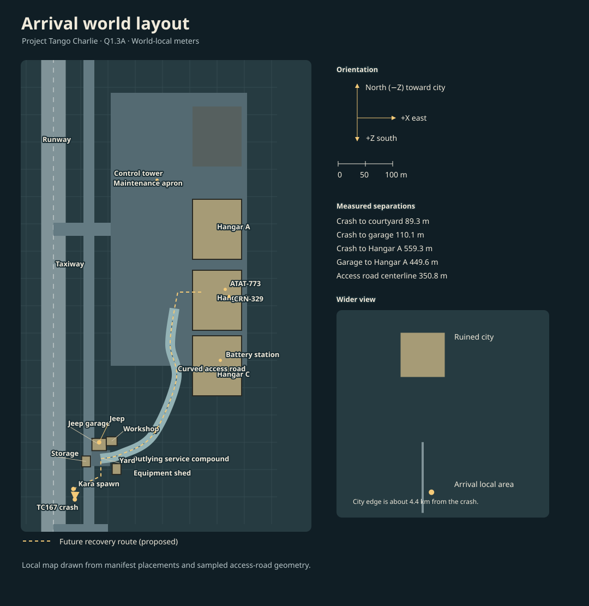

# Arrival world layout — Q1.2C

The detail map shows the manifest's placements, transformed building footprints, pavement, and sampled access-road centerline. The overview locates the airport and compound relative to the existing city. North is −Z, east is +X, and the local grid is in meters. The dashed recovery route is a planning overlay for a future loaded trolley.

## Distances

| Measurement | Horizontal distance |
| --- | ---: |
| TC167 wreck to courtyard center | 89.3 m |
| TC167 wreck to service garage | 110.1 m |
| TC167 wreck to Hangar A center | 559.3 m |
| Service garage to Hangar A center | 449.6 m |
| Courtyard center to Hangar A center | 470.3 m |
| Curved access road, yard to apron | 350.8 m along centerline (previously 273.9 m) |
| TC167 wreck to nearest city boundary | 4,404.8 m |

Travel on foot or by Jeep includes passages through the yard and apron. Q1.2C uses the owner's surveyed wreck and courtyard positions. The compound moved as one group by (−63.230, 0, +48.158) m. Only the first three access-road control points moved. The final airport approach, both hangars and their contents, the runway, taxiways, apron, city, and sandbox layout retain their Q1.2B placements.

## Placements

Positions use manifest X, Y, Z. Dimensions below are measured in the building's local length axes before world yaw, including manifest scale.

| Feature | Center (m) | Yaw | Local X × height × Z (m) |
| --- | --- | ---: | --- |
| Wreck spawn | (39.169, 0, 4854.771) | 57° | Existing TC167 hull |
| Kara spawn | (36.537, 0, 4835.701) | 35.3° | Existing character |
| Jeep garage | (83.77, 0, 4754.158) | 90° | 22.5 × 5.76 × 26.4 |
| Equipment shed | (115.77, 0, 4799.158) | 0° | 16.2 × 4.8 × 19.8 |
| Storage | (59.77, 0, 4785.158) | 180° | 16.2 × 4.8 × 19.8 |
| Workshop | (106.77, 0, 4748.158) | −90° | 16.2 × 4.8 × 19.8 |
| Hangar A | (300, 0, 4360) | 0° | 90 × 24 × 110 |
| Hangar B | (300, 0, 4490) | 0° | 90 × 24 × 110 |
| Maintenance apron | (230, 0, 4360) | 0° | 250 × 500 m footprint |
| Compound courtyard | (86.770, 0, 4779.158) | 0° | 34 × 29 m footprint |
| Runway | (0, 0, 3860) | 0° | 45 × 2,400 m footprint |

The wreck uses manifest yaw 57° with a local +Z forward axis. Under the navigation convention, that gives **123.0°**. Ground support puts the resting aircraft origin at Y +1.100 m. In a new campaign, Kara starts on foot at a feet position of (36.537, 0.000, 4835.701) m, 19.3 m horizontally from the aircraft origin and outside its collision bounds. Her manifest yaw of 35.3° gives a navigation heading of **144.7°**, and the third-person camera starts behind her, aligned with that heading. Existing saves retain their saved positions and facing. The Jeep retains its previous garage-relative position and heading. The garage opens onto the courtyard. The access road joins the courtyard on one side and blends into the apron on the other. At the apron, one route leads to Hangar A parking and the other lines up with Hangar B's vehicle gate. The apron link and existing taxiways connect to the runway.

The crash is off the paved road. The proposed recovery leg uses the yard, passes beyond the storage building, then turns across open ground toward the wreck. The 18 m road and the existing gate are available for planning. Loaded-trolley swept clearance remains a future verification task.

## Regeneration and saves

Run `python -m tools.map_arrival` from the repository root. The utility resolves GLB footprints from the same authored placements used by gameplay and samples the same spline as the runtime road. Labels and the proposed recovery leg are editorial annotations.

Use `python main.py --campaign --campaign-save saves/arrival-q12c.json` for a new Q1.2C playthrough without replacing an older campaign. The save carries a layout identifier. Q1.2A and Q1.2B saves continue on their original manifest and object positions, and older legacy campaigns retain their existing compatibility.
