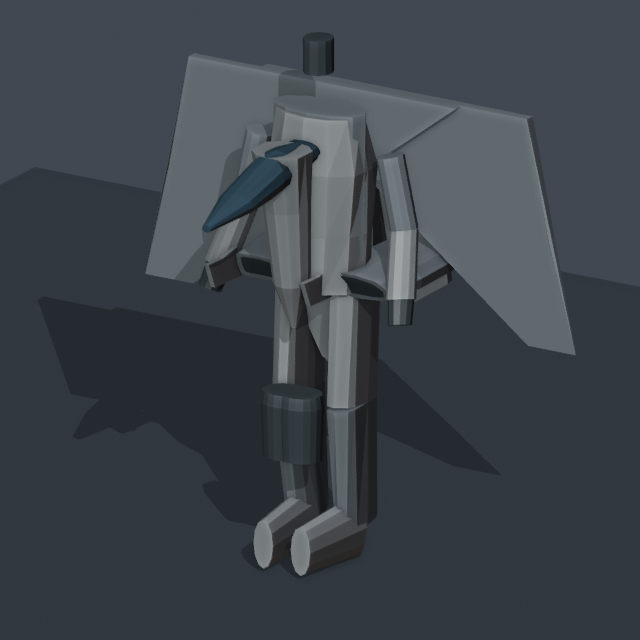
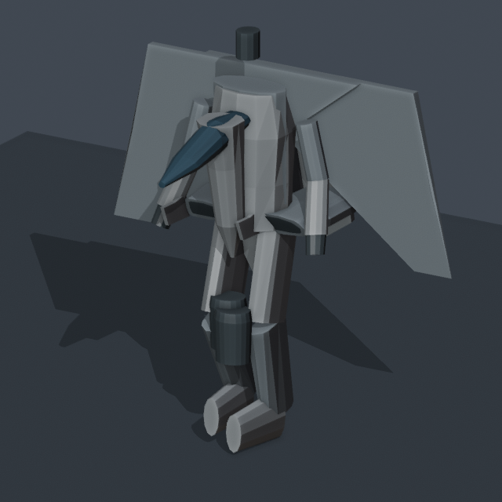
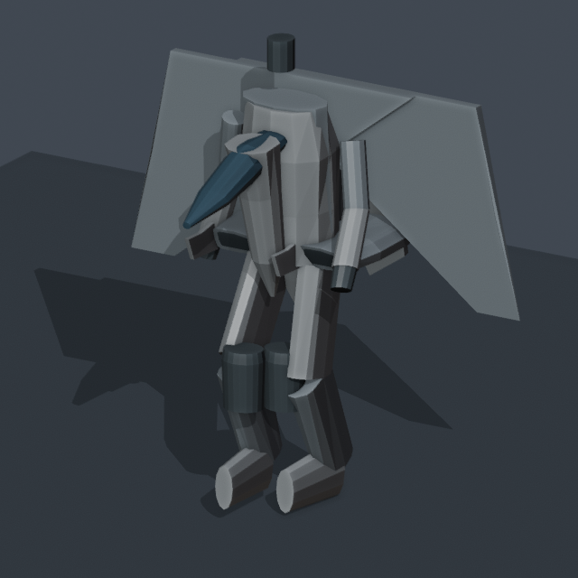

# TC167 animated Blender authoring setup — M21.1

Open [TC167_Animated.blend](../assets/blender/TC167_Animated.blend) in Blender 5.0.1.
It opens at frame 1 in the canonical BATTLEDROID stance, with `BD_Idle` active and
the viewport framed for editing. The original `TC167.blend` and `tc167.glb` were
preserved. The separate runtime asset is
[tc167_animated.glb](../assets/models/vehicles/tc167_animated.glb).

These are working starter cycles for further artistic refinement. Blender plays
stored object keyframes directly. The saved helper script only switches Action
slots; playback has no Python drivers, armature, or skeletal skinning.

## Actions and timing

Each Action has 36 rigid-object slots, 360 editable FCurves, and closed endpoints.
The scene uses 24 FPS. The duplicate endpoint closes the cycle; elapsed duration
is `(last frame - first frame) / 24`, rather than counting the endpoint twice.

| Action | Frames | Duration | Real keyframe points | Motion |
| --- | --- | --- | ---: | --- |
| BD_Idle | 1–49 | 2 seconds | 17,640 | 12 mm torso movement, subtle shoulders/head, fixed feet |
| BD_Walk | 1–25 | 1 second | 9,000 | Alternating planted/lifted feet, knees, opposing arms, torso counterrotation |
| BD_Run | 1–19 | 0.75 seconds | 6,840 | Longer stride, faster articulation, stronger arm swing, 6° forward lean |

Root translation and orientation are constant throughout all three loops. Walk
uses a 1.20 m stance sweep over 60% of its cycle, matching the M21 nominal 2 m/s.
Run uses a 1.89 m stance sweep over 42% of its cycle, matching nominal 6 m/s.
The legs use their existing 2.6 m links, with modest suspension compression and
flat ankle orientation. Walk swing-foot lift is 0.23 m; run lift is 0.40 m.
The head counteracts body lean and receives restrained motion rather than tracking
every arm/leg movement.

Curve keys use LINEAR interpolation and Cycles modifiers for editing/playback.
The exported glTF uses supported LINEAR and STEP samplers. You can refine the
Blender curves in the Graph Editor; the supplied exporter samples them every frame.

## Preview and select clips

1. Open the animated file and press Space to play the active idle cycle.
2. In a Text Editor, select the saved `TC167_Action_Controls.py` text and choose
   **Run Script** once. Open the 3D Viewport sidebar (`N`) and select **TC167**.
3. Click `BD_Idle`, `BD_Walk`, or `BD_Run`. Each button assigns all relevant object
   slots to the shared Action and sets its matching playback range.
4. Select a joint such as `LeftUpperLeg`, `RightLowerLeg`, `LeftFoot`, `TorsoCore`,
   `LeftUpperArm`, or `Head`. Use Dope Sheet → Action Editor to edit its slot, and
   the Graph Editor to edit Location, Quaternion Rotation, and Scale curves.
5. Preserve matching first/last keys for seamless looping. Save your `.blend` edits
   before running the export command.

The three Actions are also retained in muted single-strip NLA tracks. These archive
the Actions for export; they do not stack multiple gaits on the model. The helper
turns NLA evaluation off while assigning the selected Action. Changing the Action
on one selected object in the Action Editor changes only that object's slot;
the sidebar buttons switch the whole machine together.

`TC167_README`, `TC167_FIGHTER_BASIS.json`, and `TC167_GEOMETRY_BASELINE.json` are
saved Text datablocks containing instructions and export/rest-preservation metadata.
The BD animation data lives in the Actions' FCurves.

## Restore FIGHTER

Click **FIGHTER_Rest** in the TC167 sidebar. This real restoration Action assigns
all 68 runtime objects their production transforms at frame 0. Reopening the file
and evaluating this Action was verified to reproduce the original Blender local
matrices exactly, including the original mirrored parts.

Click **BD_Idle** to return to the standing BATTLEDROID reference. Do not apply
transforms, change origins, clear parent inverses, or edit meshes to switch poses.

## Hierarchy, units, and coordinate conversion

The source Blender file has 71 objects: the 68 runtime nodes and three existing
helper empties (`Empty`, `Empty.001`, and `Empty.002`). All remain in the authoring
copy. Export selects the production 68-node hierarchy rooted at `TC167Root`.

| Nodes | Existing parent | Role |
| --- | --- | --- |
| Fuselage | TC167Root | Main body configuration/lean |
| TorsoCore, Head | Fuselage | Torso and head articulation |
| Left/RightIntake | TC167Root | Hip carrier and intake geometry |
| Left/RightUpperLeg | Corresponding Intake | Hip articulation |
| Left/RightLowerLeg | Corresponding UpperLeg | Knee articulation |
| Left/RightFoot | Corresponding LowerLeg | Ankle and foot placement |
| Left/RightShoulder | TC167Root | Shoulder pivot |
| Left/RightUpperArm | Corresponding Shoulder | Arm swing |
| Left/RightForearm, Hand | Corresponding UpperArm, Forearm | Elbow and hand chain |
| Left/RightEngine | TC167Root | Root siblings whose foot attachments are baked into object keys |

Mesh companions keep their original parents, geometry, and material assignments.
The existing `BATTLEDROID_POSE` supplies the absolute parent-local reference values;
`TransformationController.reset(BATTLEDROID)` also evaluates the authoritative
engine attachment transforms. The idle cycle's first pose matches that result
within **0.000000573** maximum matrix-component error after Blender/float32 export.

Source glTF coordinates use +Y up and +Z toward the nose. Blender uses +Z up:

```text
Blender (X, Y, Z) = glTF (X, -Z, Y)
Blender quaternion = (w, x, y, z)
glTF quaternion    = (x, y, z, w)
```

For conversion matrix `C`, source node-local matrices become `C M C⁻¹`. Six source
mesh objects have nonidentity parent inverses: the three right intake surfaces and
the right upper-leg, lower-leg, and foot mesh companions. The keyed Blender basis
is `parent_inverse⁻¹ C M C⁻¹`; their existing parent inverses remain unchanged.
The game's separate 180° Y root conversion is applied by its renderer, not baked
again into the Blender object animation.

One unit is one meter. The canonical root datum is 3.2873 m upward, and the soles
stand near Blender Z = −3.2 m because the model is expressed relative to the
physical center of mass. The root datum stays constant within each loop. The game
adds its world-space vehicle position independently.

## Export saved artist edits

Run from the project root after saving the Blender file:

```sh
/Applications/Blender.app/Contents/MacOS/Blender \
  --background --factory-startup --python-exit-code 1 \
  --python tools/author_tc167_blender.py -- \
  --export-only \
  --blend-input assets/blender/TC167_Animated.blend \
  --glb-output assets/models/vehicles/tc167_animated.glb

python -m tools.inspect_glb_animations \
  assets/models/vehicles/tc167_animated.glb --require-bd-clips

python main.py --vehicle-model assets/models/vehicles/tc167_animated.glb \
  --battledroid-test ground --enemies 0
```

`--export-only` reads your saved FCurves and exports their current values. It does
not regenerate the starter cycles or save over the `.blend` file. A verification
edit to an actual torso keyframe was exported and detected in the resulting glTF
channel values.

The exporter restores the original FIGHTER basis for the temporary Blender export,
uses Actions mode with merge-by-Action, samples at one-frame intervals, and slides
clip time to zero. It selects the production hierarchy and exports no skin, morph,
camera, light, or flattened hierarchy.

For the game GLB it retains the original production document's geometry, materials,
node-local rest TRS, and binary geometry prefix exactly, then appends animation
accessors decoded from Blender's export. Targets are mapped by unchanged node
names to their original indices. This keeps the saved BATTLEDROID authoring pose
from becoming a new incompatible bind pose. Use this command when exporting to
the M21 runtime so the production rest/material contract remains intact.

Mesh, material-assignment, hierarchy, or parent-inverse edits are rejected by the
saved geometry baseline. Animation edits remain editable and exportable. The
original `TC167.blend` and `tc167.glb` are protected output paths.

To generate another starter copy, choose a new output filename:

```sh
/Applications/Blender.app/Contents/MacOS/Blender \
  --background --factory-startup --python-exit-code 1 \
  --python tools/author_tc167_blender.py -- \
  --blend-output assets/blender/TC167_Animated_New.blend \
  --glb-output assets/models/vehicles/tc167_animated_new.glb
```

Creation refuses to overwrite an existing authoring file. Use export-only for
normal work on the prepared file.

## Rendered samples

These Blender Workbench renders use a temporary preview floor and camera that were
not saved into the model file.

| Idle | Walk | Run |
| --- | --- | --- |
|  |  |  |

## Validation

- Original Blender and production GLB SHA-256 hashes remain unchanged.
- Reopened authoring copy: object names, hierarchy, parent inverses, mesh
  coordinates/topology/UVs, material assignments, and material shader data match
  the source. Unused source materials/meshes are retained using fake users.
- All Actions contain genuine keyframes, with matching endpoints and no root
  displacement. The file contains no armature.
- Native GLB geometry/material arrays and FIGHTER rest matrices are exact copies
  of production data; all three clips pass the M21 loader.
- Idle feet are fixed. Dense native sampling found walk/run contact interpolation
  error below 2.1 mm around the canonical floor; swing feet lift as intended.
- Seven new asset tests pass, including full game updates with identical physics
  for native/procedural backends and preserved transformation endpoints.
- Complete suite: **427 tests, 425 passed, two unchanged pre-existing failures**
  concerning wing bounds and mirrored pose scales. Existing 35 lint findings remain.

Detailed machine-readable results are in
[TC167_AUTHORING_VALIDATION.json](TC167_AUTHORING_VALIDATION.json). Physics,
locomotion decisions, transformation logic, and the M21 animation engine were not
changed for this milestone.
